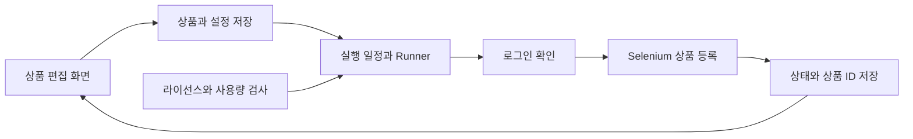

<div align="center">

# 🛍️ EXP 번장 상품 등록·관리

### Windows Forms · 상품 목록 · 브라우저 작업 · 예약 실행

상품 정보를 목록으로 정리하고 등록 흐름과 진행 상태를 관리합니다.<br>
Windows 화면, Selenium 브라우저 작업, 일정·라이선스·사용량 처리를 연결한 EXP 프로젝트입니다.


[빠른 시작](#quick-start) · [저장소 구성](#repository-structure) · [상품 데이터](#data-settings)

</div>

---

<a name="introduction"></a>

## ✨ 프로젝트 소개

EXP는 상품 목록을 편집하고 Chrome에서 등록 작업을 실행하는 Windows 앱입니다. 실행자는 로그인·진행 상태를 확인하고 작업을 일시정지하거나 중단할 수 있습니다. 여러 차수의 앱·관리자·공통 코드와 검사 코드를 함께 보존합니다.

| 기능 | 구현 내용 |
| :--- | :--- |
| 상품 편집 | 제목·가격·카테고리·사진·설명·배송 조건 |
| 등록 실행 | 로그인 확인 후 유효한 상품을 목록 순서로 처리 |
| 진행 제어 | 백그라운드 실행·진행률·일시정지·중지 |
| 예약 반복 | 개별 간격과 전체 목록 반복 일정 |
| 브라우저 관리 | Chrome 경로·드라이버·전용 프로필 처리 |
| 운영 관리 | 라이선스·사용량·진단 기록과 관리자 도구 |



<a name="repository-structure"></a>

## 📁 저장소 구성

20차를 중심으로 주요 경로를 발췌했습니다. 이전 차수는 버전 기록과 함께 보존합니다.

```text
.
├── 2차/ … 20차/
├── 20차/소스코드/
│   ├── EXP.csproj
│   ├── src/
│   │   ├── Program.cs
│   │   ├── MainForm.cs
│   │   ├── Models.cs
│   │   ├── Runner.cs
│   │   ├── Bot.cs
│   │   ├── DriverManager.cs
│   │   ├── Storage.cs
│   │   └── BatchRepeatSchedule.cs
│   ├── shared/
│   ├── admin/
│   ├── tests/
│   └── tools/
└── docs/VERSIONS.md
```

- [프로젝트 설정](20차/소스코드/EXP.csproj), [상품 모델](20차/소스코드/src/Models.cs).
- [실행 제어](20차/소스코드/src/Runner.cs), [브라우저 작업](20차/소스코드/src/Bot.cs).
- [공통 코드](20차/소스코드/shared/), [검사 코드](20차/소스코드/tests/), [버전 기록](docs/VERSIONS.md).

<a name="implementation"></a>

## 🧩 주요 기술과 실행 흐름

20차 프로젝트 설정은 .NET Framework 4.7.2, Windows Forms, C# 7.3을 사용합니다. Selenium ChromeDriver로 웹 화면을 조작하고 Newtonsoft.Json을 사용하는 데이터 모델을 포함합니다.

`Runner.Run()`은 라이선스·사용 모드를 확인하고 로그인에 성공한 뒤 상품을 처리합니다. 상품별 상태를 갱신하고 저장 콜백과 진행률을 전달합니다. 중지·일시정지 요청은 작업 단계 사이에서 확인합니다. 웹 화면의 구조가 바뀌면 선택자와 등록 동작을 다시 확인해야 합니다.

`Bot.Register()`는 상품 입력 뒤 화면에 배송 조건이 실제 반영되었는지 확인합니다. 제출 후 상품 ID를 확인한 경우에 상태와 게시 시각을 저장합니다. 이미지는 존재하는 JPG·JPEG·PNG 중 최대 12개, 태그는 최대 5개·각 9자로 처리하는 코드입니다. 로그인은 브라우저에서 사용자가 직접 진행합니다.

### 라이선스와 관리자 도구

| 구성 | 역할 |
| :--- | :--- |
| 기기 등록 | Windows TPM의 P-256 키로 기기 등록 요청과 키 소유 확인 |
| 라이선스 검증 | LV3·LV4 토큰의 Ed25519 서명, 기기·기간·제품 조건 확인 |
| 발급 도구 | 관리자 키를 현재 Windows 사용자의 DPAPI로 보호해 `issuer.dpapi`에 저장 |
| 추가 등록권 | 서명된 EXPC1 등록권의 기기·수량·중복 사용 여부 확인 |
| 체험판 | 이메일·기기 발급 기록을 확인하는 Pro 3시간 체험판 구성 |
| 사용량 | 한국 날짜 기준 기기 사용량과 일일 한도 관리 |

20차의 일일 한도 설정은 Classic 25회·Studio 50회·Pro 100회입니다. 이는 해당 코드의 정책이며 실제 판매 조건을 나타내는 안내는 아닙니다. 로컬 사용량 보호는 관리자에 의한 전체 기기 스냅샷 되돌리기까지 방지하는 구조는 아닙니다.

### 예약과 차수별 기록

20차는 시작 시 설정과 상품 목록의 사본을 만들어 실행 중 편집과 구분합니다. 전체 목록 반복은 완료 시각보다 미래인 다음 간격 또는 매시 지정분을 계산합니다. 실패 상품이 있거나 실제 시도할 상품이 없으면 반복을 중단합니다. 예약에는 30분 이내 유효한 서버 시각 표본이 필요합니다.

최신 20차 진입점은 이 PC의 활동 집계와 로컬 구조화 로그를 연결합니다. 6~8차에는 별도 Python·SQLite 중앙 로그 서버, 9차에는 선택적 전송 클라이언트가 있습니다. 9차 공개 설정의 서버 주소와 등록 키는 비어 있어 기본 원문만으로 전송이 활성화되지 않습니다. 로컬 로그에는 Redactor 정리가 적용되지 않으므로 운영 로그를 그대로 공유하지 않아야 합니다.

설정·상품의 Vault는 PC 식별자를 재료로 한 PBKDF2와 AES-CBC·HMAC 보호입니다. 발급자 개인키의 DPAPI 저장과 구별합니다. 상품 CSV는 따옴표·개행·CP949 등 입력을 처리하지만, 스프레드시트 수식 접두 문자를 따로 차단하지 않습니다. `Brand.Email`을 사용하는 화면에는 공백이 아닌 `CONTACT_EMAIL` 환경변수가 필요합니다.

<a name="quick-start"></a>

## 🚀 빠른 시작

1. Windows에서 .NET Framework 4.7.2 개발 환경을 준비합니다.
2. 사용할 차수의 프로젝트 설정과 `lib/` 참조를 확인하고 Selenium·JSON 라이브러리 등 필요한 의존성을 준비합니다.
3. 프로젝트가 참조하는 아이콘·폰트·도움말 리소스를 해당 차수의 정당한 원본에서 준비합니다.
4. 전체 입력이 준비된 개발 환경에서 프로젝트를 빌드합니다.

```powershell
cd "20차/소스코드"
.\build.bat
```

`build.bat`는 `build/Build.ps1`로 위임하는 원래 빌드 진입점입니다. 현재 공개 사본에는 위임 대상 스크립트, `lib/` DLL, 아이콘·manifest·폰트 등 빌드 리소스가 없어 그대로 실행하면 빌드가 완료되지 않습니다. 완전한 원본 개발 환경의 빌드 절차로 구분해 보세요. 관리자 발급 도구의 개인키·서버 설정은 자신의 별도 환경에서 관리해야 합니다.

실행 시에는 본인이 관리하는 상품과 계정으로 로그인 상태·상품 내용·적용 서비스의 이용 조건을 확인하세요. 이 저장소 공개 작업에서는 상품을 실제 등록하지 않았습니다.

<a name="data-settings"></a>

## 📊 상품 데이터와 실행 설정

| 항목 | 코드의 구성 |
| :--- | :--- |
| 상품 핵심 필드 | 제목, 가격, 카테고리, 상태, 수량, 태그, 사진, 설명 |
| 사진 경로 | 세미콜론으로 구분하는 문자열 |
| 배송 설정 | 무료배송·일반 배송비·반값배송 관련 값 |
| 실행 결과 | 상태, 상품 ID, 마지막 게시 시각 |
| 설정 저장 | `settings.json` |
| 상품 저장 | `products.json` |
| 화면 선택자 | `selectors.json` |

기본 저장 루트는 사용자 AppData의 `BunjangAuto`이며 브라우저 프로필에는 별도의 영문 경로 처리도 있습니다. `Product.IsValid`의 기본 검사는 제목과 가격의 비어 있지 않음입니다. 이것만으로 가격·카테고리·사진·판매 정책의 모든 조건이 충족되었다고 해석하지 않습니다.

`DumpPages()`가 만드는 진단 ZIP에는 열린 화면의 HTML·이미지·URL이 들어갈 수 있습니다. 상품 목록·브라우저 프로필·발급 기록·진단 화면은 사용자 운영 데이터이므로 소스와 분리해 보관합니다. 일반 제품과 시험 빌드도 구분합니다. `--selftest` 분기는 `TESTBUILD` 조건에서만 포함됩니다.

<a name="troubleshooting"></a>

## 🛠️ 문제 해결

| 증상 | 확인할 내용 |
| :--- | :--- |
| 컴파일 참조 오류 | `lib/` 의존성과 .NET Framework 개발 환경 |
| 리소스 파일 오류 | 아이콘·나눔고딕 Bold·도움말 입력 |
| Chrome 시작 실패 | Chrome 경로·드라이버 호환성·전용 프로필 |
| 로그인에서 중단됨 | 실제 브라우저 로그인 상태와 수동 로그인 안내 |
| 등록 화면을 찾지 못함 | 현재 웹 화면과 저장된 선택자 |
| 반복 작업이 중단됨 | 로그인·사용량·중지 요청·상품별 상태와 로그 |
| 관리자 발급 실패 | 공개 사본에 없는 개인키와 별도 운영 설정 |

---

<div align="center">

**상품 목록과 실행 상태를 한 흐름으로 관리합니다.**

</div>
